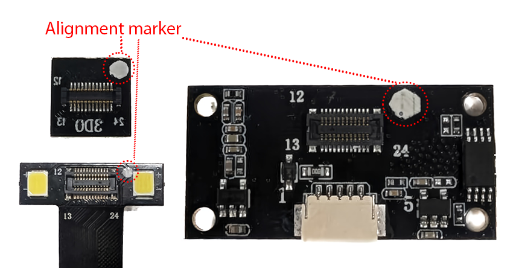
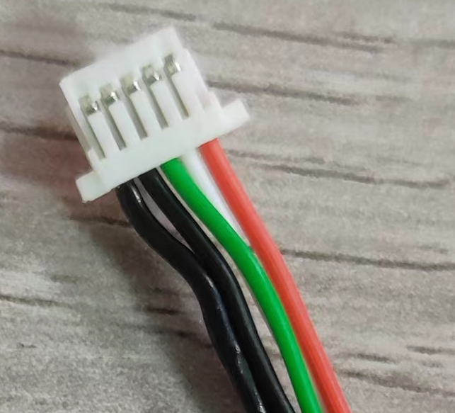
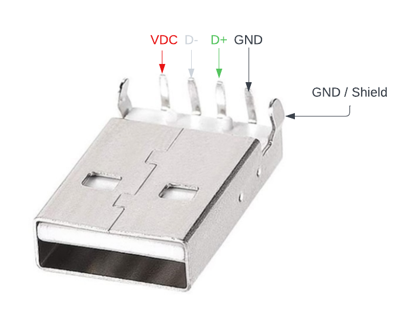
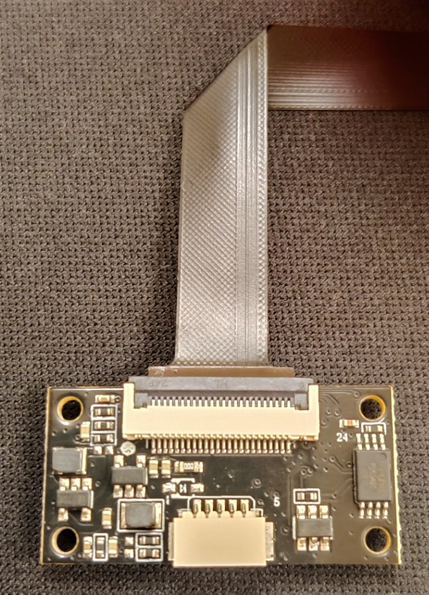

# 3DO Enclosure & Nozzle Camera V2.5

## What's new in V2.5

- **New DSP:** Improved image quality with 3D denoise and an added 90 fps option at 720p and below.
- **New FPC:** Half the width of the V2 FPC, with new high-CRI LEDs for improved color rendering.
- **Removable LEDs:** If you prefer an FPC without LEDs, you can cut them off with scissors along the white line marked on the PCB.
- **V2 compatibility:** V2.5 and V2 hardware components are interchangeable.

The improved image processing and 90 fps modes require the V2.5 DSP board.

The 3DO Enclosure & Nozzle Camera V2.5 is a USB camera system for 3D printers. The DSP board and camera sensor are sold together, with interchangeable FPC cables for flexible placement.

## CAD Files & Community Mounts

### Design Files

Find CAD files and component tolerances in the [Design Files](./Design%20files/) folder to help you design your own mounts.

**V2.5 CAD:** [NC_LED-FPC_PCB_V2.5.step](./Design%20files/NC_LED-FPC_PCB_V2.5.step) — Nozzle camera, LED FPC, and DSP PCB assembly.

### Community Mounts

3DO provides the camera hardware; most mount designs are created by the community.

**V2.5 compatibility:** The only dimensional change from V2 is the FPC width: the V2.5 FPC is half as wide. The mounts below were designed for V2 and have not yet been verified with the narrower V2.5 FPC. We are reviewing the list and will update or remove entries so that only V2.5-compatible mounts remain.

Want to add your mount to the list? Open an [issue](https://github.com/3DO-EU/Enclosure-Nozzle-Camera-V2/issues/new) or submit a [pull request](https://github.com/3DO-EU/Enclosure-Nozzle-Camera-V2/pulls) to this repository. Include a link to your design, the supported printer, camera and FPC requirements, and your name for credit.

| Printer                  | Camera Type         | FPC Type           | Designer     | Mount Link                                                                                  |
|--------------------------|---------------------|--------------------|--------------|--------------------------------------------------------------------------------------------------|
| Voron 2.4 Stealth Burner | Nozzle Camera Glued | 25 cm LED & No LED  | Olof Ogland  | [3DO Nozzle camera V2 for Stealthburner](https://www.printables.com/model/911230-3do-nozzle-camera-for-stealthburner) |
| Voron 2.4 Stealth Burner | Nozzle Camera Glued | 25 cm LED  | Adam Naguszewski  | [Stealthburner Knomi V2 3do V2 UHF LED](https://makerworld.com/en/models/650758#profileId-577381) |
| Voron 2.4 | Enclosure Camera | 5 cm | Jochen Ullrich | [3DO Enclosure Cam v2 for Voron 2 Corner Mount](https://www.printables.com/model/961720-3do-enclosure-cam-v2-for-voron-2-corner-mount) |
| VzBot | Nozzle Camera Glued | 5 cm LED | Jochen Ullrich | [3DO Nozzle Camera V2 for VzBot](https://www.printables.com/model/915664-3do-nozzle-camera-v2-for-vzbot) |
| V-core 4 | Nozzle Camera Glued | 10 cm LED | Dennis Jespersen| [EVA 3DO nozzle cam V2 setup for V-core 4](https://www.printables.com/model/922752-eva-3do-nozzle-cam-setup-v2-for-v-core-4) |
| Ratrig / Voron | Enclosure Camera | N/A | Dennis Jespersen| [3DO usb cam V2 Mount for enclosure](https://www.printables.com/model/917664-3do-usb-cam-v2-mount-for-enclosure) |
| Focus tool | Enclosure Camera | N/A | Dennis Jespersen| [3DO Enclosure CAM focus adjuster](https://www.printables.com/model/945044-3do-enclosure-cam-focus-adjuster) |
| VzBot | Nozzle Camera Glued | 10 cm LED | Kenneth Sørensen| [VzBot WaterCooled 3DO cam duct + mount](https://www.printables.com/model/923972-vzbot-watercooled-3do-cam-duct-mount) |
| Prusa MK4/MK4S | Nozzle Camera Glued | 5 cm LED | Michael | [Nozzle Cam Mount Prusa MK4/MK4S for 3DO Nozzle Cam V2](https://www.printables.com/model/1077259-nozzle-cam-mount-prusa-mk4mk4s-for-3do-nozzle-cam) |
| Prusa Core One | Nozzle Camera Glued | 25 cm LED | Julia Rose | [3DO nozzle camera mount for Prusa Core One - 25 cm FPC with LEDs](https://www.printables.com/model/1469543-core-one-3do-nozzle-camera-mount-25cm-fpc-with-led) |
| Prusa Core One | Nozzle Camera Glued | 5 cm LED | Julia Rose | [3DO nozzle camera mount for Prusa Core One - 5 cm FPC with LEDs](https://www.printables.com/model/1452709-3do-nozzle-camera-mount-for-prusa-core-one) |

## Key Features
- **Interchangeable FPC Cables**: Choose the cable length that suits your setup.
- **High-CRI Lighting**: All FPC lengths include high-CRI LEDs that can be cut off if not needed.

## IMPORTANT - Camera Sensor PCB Orientation

The small connector in our modular system allows for the possibility of incorrect orientation when mounting the camera sensor, which can potentially DAMAGE the camera.

**Please note the following when mounting the sensor/FPC/DSP to each other:**

- **Keep an eye on the white dot on the silkscreen.**
- When mounted, the white dots on both the camera sensor PCB and the DSP PCB should touch or "kiss" each other.

This ensures correct alignment and prevents damage to the components.           

                                                                                                                                                                                     

## FPC Cable Options
- 5 cm with removable high-CRI LEDs
- 10 cm with removable high-CRI LEDs
- 25 cm with removable high-CRI LEDs

All lengths come with high-CRI LEDs. If you prefer an FPC without LEDs, you can cut them off with scissors along the white line marked on the PCB.

## Camera Options
- **Nozzle Camera (Glued)**: The lens is fixed at a focus distance of 34.5 mm, measured from the back of the FPC to the subject.
- **Nozzle Camera (Adjustable)**: Lens focus can be adjusted by rotating the lens.
- **Enclosure Camera (Adjustable)**: Lens focus can be adjusted by rotating the lens, FoV 120°.

## Specifications
|                         | 4K (Sony IMX258)     |
|-------------------------|----------------------|
| Sensor Size             | 1/3.06               |
| Mega-Pixel              | 13 MP                 |
| Frame Rate*             | 30FPS@4K 60FPS@1080P 90FPS@720P*|
| Operating temperature | -20°C TO 65°C        |

_*Frame rates are achievable when connected directly. Performance may vary with different streaming setups._

## Pinout
PCB uses a 5P 1.0mm pitch connector.
| Pin No. | Function    | Color                |
|---------|-------------|----------------------|
| 1       | USB 5VDC    | Red                  |
| 2       | Data -      | White                |
| 3       | Data +      | Green                |
| 4       | USB -VDC/GND| Black                |
| 5       | GND/Shield  | Black (heat shrink)  |

Wire no. 5 is an optional shield/drain wire. Though optional, its installation is recommended.

 

## Software

The camera functions as a standard UVC web camera and is compatible with Linux, Windows, and macOS. For streaming, we recommend using [Mainsail](https://github.com/mainsail-crew/mainsail) and [Crowsnest](https://github.com/mainsail-crew/crowsnest).

The camera system supports various controls and options, primarily managed via v4l2-ctl commands. Below are the detailed controls and their options available through v4l2-ctl:

### User Controls

| Control                     | Details                                                                 |
|-----------------------------|-------------------------------------------------------------------------|
| **brightness**              | min=0, max=64, step=1, default=15                                       |
| **contrast**                | min=0, max=95, step=1, default=4                                        |
| **saturation**              | min=0, max=100, step=1, default=70                                      |
| **hue**                     | min=-2000, max=2000, step=1, default=0                                  |
| **white_balance_automatic** | default=1                                                               |
| **gamma**                   | min=1, max=300, step=1, default=115                                     |
| **gain**                    | (ISO control) min=0, max=480, step=1, default=0                         |
| **power_line_frequency**    | min=0, max=2, default=1                                                 |
|                             | 0: Disabled                                                             |
|                             | 1: 50 Hz                                                                |
|                             | 2: 60 Hz                                                                |
| **white_balance_temperature** | min=2800, max=6500, step=1, default=4600, flags=inactive              |
| **sharpness**               | min=1, max=7, step=1, default=1                                         |
| **backlight_compensation**  | min=0, max=2, step=1, default=1                                         |
|                             | 0: LED off                                                              |
|                             | 1: LED on when stream is open                                           |
|                             | 2: LED always on                                                        |

### Camera Controls

| Control                    | Details                                                                  |
|----------------------------|--------------------------------------------------------------------------|
| **auto_exposure**          | min=0, max=3, default=3                                                  |
|                            | 1: Manual Mode                                                           |
|                            | 3: Aperture Priority Mode                                                |
| **exposure_time_absolute** | min=3, max=2047, step=1, default=166, flags=inactive                     |
| **pan_absolute**           | min=-648000, max=648000, step=3600, default=0                            |
| **tilt_absolute**          | min=-648000, max=648000, step=3600, default=0                            |
| **focus_absolute**         | min=0, max=1023, step=1, default=0, flags=inactive                       |
| **focus_automatic_continuous** | default=0                                                           |
| **zoom_absolute**          | min=0, max=60, step=1, default=0                                         |

**Notes:**

- `exposure_time_absolute` controls the shutter speed and can only be set when `auto_exposure` is in manual mode.

- PTZ controls (`pan_absolute`, `tilt_absolute`, `zoom_absolute`) are used to crop the image. All 30fps streams are downscaled to 4K, and all 90/60fps streams are downscaled to 1080p. To use the crop feature, you need to select a downscaled stream.

## FAQ
- **Does it work in an enclosed printer?**

  Yes, our camera is rated for 65°C but has been tested in an 80°C industrial heat chamber for 48 hours without issues.
  
- **Why don't you offer autofocus cameras?**

  In our experience and testing, autofocus cameras are not ideal for 3D printer use. For nozzle cameras, the lens shakes with fast movements, leading to quicker breakdowns and shorter lifespans. For enclosure cameras, most customers set a fixed focus for autofocus cameras anyway, so we opted for fixed-focus cameras for reliability, as it is one less part that can break.
  
- **Can I bend/fold the FPC cable to make it shorter?**

  Yes, FPC cables are flexible and can be bent. For folding (180 degrees), limit this to one time at the same spot to avoid damaging the conductive traces inside the FPC.

Example of folding FPC:

## Where to Buy
### EU / UK

### USA

This work is licensed under <a href="https://creativecommons.org/licenses/by-nc-sa/4.0/?ref=chooser-v1" target="_blank" rel="license noopener noreferrer" style="display:inline-block;">CC BY-NC-SA 4.0</a>

